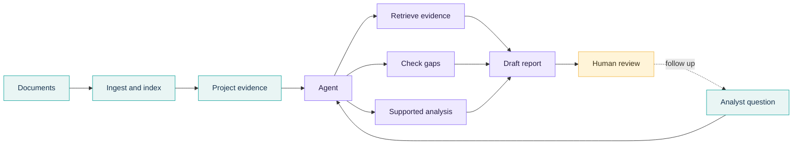
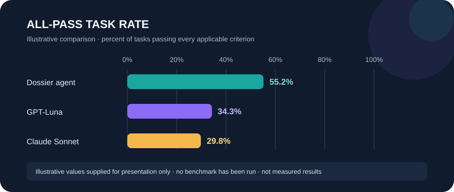

# Dossier

<p align="center">
  <strong>Turn a document pile into a reviewable investment brief.</strong><br />
  An evidence-first due diligence workspace with an AI agent that shows its work.
</p>

<p align="center">
  
  
  
  
</p>

Dossier helps investment analysts review product documents, find evidence and gaps, run supported checks, and draft reports for human review. It is a personal job-hunting project demonstrating product thinking, workflow design, and agent evaluation.

## The workflow

Due diligence information is scattered across disclosures, questionnaires, fee schedules, portfolio materials, and meeting notes. Dossier brings the review into one project workspace and makes unknowns visible instead of guessing through them.



**Design principles:** Ground claims in project evidence; distinguish facts, conflicts, and unknowns; keep agent tools bounded; leave interpretation and approval with the analyst. The orchestrator handles persistence, while retrieval stays scoped to the active project.

## Evaluation: measure the failure modes

A useful answer must be accurate against the supplied evidence, cite it correctly, cover the task, identify gaps, and handle uncertainty. The evaluation prototype proposes paired runs on the same closed evidence bundle, with anonymized outputs, atomic rubric scoring, and human review of failures, disputes, and a sample of passes.



*Illustrative values only. No benchmark has been run; these are not measured results.*

| Evaluation area | Signals |
| --- | --- |
| **Answer quality** | Relevance, factual correctness, completeness, evidence and citation support |
| **Risk handling** | Gap detection, uncertainty, material hallucinations, human judge corrections |
| **Practicality** | Cost and latency per task |

Compare results case by case, report denominators and category breakdowns, and keep material hallucinations visible. The protocol evaluates decision support, not investment outcomes or regulatory compliance.

> **Status:** Evaluation design prototype. Cases, rubric examples, and chart values are illustrative; no benchmark has been run and no performance claim is being made. Read the [evaluation protocol](eval/README.md) for methods and limitations.

## Implementation

React + Vite frontend · FastAPI backend · project-scoped document retrieval · coverage checks · supported analyses · report drafting. The tools return findings; the orchestrator records application state. See [`backend/AGENT.md`](backend/AGENT.md) and [`specs/`](specs/).

## Run locally

### Prerequisites

Python 3.12+, [`uv`](https://docs.astral.sh/uv/), Node.js, pnpm, a Supabase project, and OpenAI and Anthropic API keys. Copy `backend/.env.example` to `backend/.env` and `frontend/.env.example` to `frontend/.env`, then fill in the values. Never put the Supabase service key in the frontend env file.

### Start the app

In one terminal:

```powershell
cd backend
uv sync
uv run alembic upgrade head
uv run python run.py
```

In another terminal:

```powershell
cd frontend
pnpm install
pnpm dev
```

For Supabase credential and migration details, see the [Supabase setup](specs/guides/supabase-setup.md), [backend guide](specs/guides/backend-setup.md), and [frontend guide](specs/guides/frontend-setup.md).

| Code and product | Evaluation and data |
| --- | --- |
| [`backend/`](backend/) API and agent · [`frontend/`](frontend/) web app · [`specs/`](specs/) product and setup notes | [`eval/`](eval/) evaluation prototype · [`data/`](data/) sample and local application data |

Dossier is a working prototype, not a production due diligence service. Its outputs support analyst work and require qualified human review.
